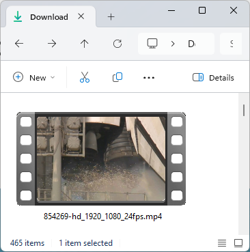
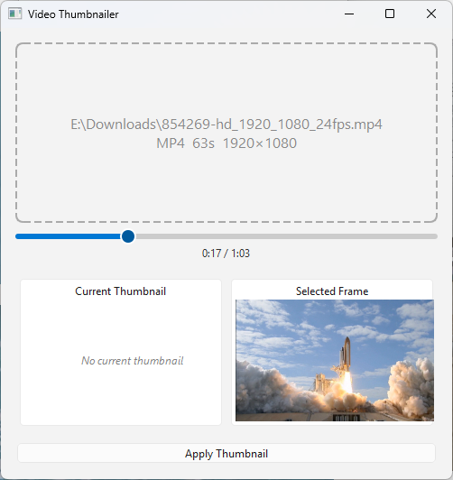
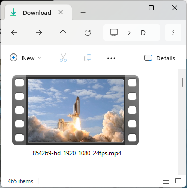

# FrameCover

Many video players and file managers generate a thumbnail by grabbing the first frame of the video — which is often a black screen, a title card, or a fade-in. This tool lets you scrub to any frame you like and embed it as the video's cover art, so the thumbnail actually shows something meaningful.

A native desktop app written in Rust with a [Slint](https://slint.dev) user
interface. Video work is done by a bundled [FFmpeg](https://ffmpeg.org).

**Supported formats:** MP4, MOV, MKV, WebM, AVI, FLV — other containers
(M2TS, MTS, MPEG-TS, WMV, …) can be converted to MP4 first.

---

## What it looks like

### Before (original thumbnail)



### Application



### After (updated thumbnail)



---

## Download

Get the latest build for Windows, macOS or Linux from the
[releases page](https://github.com/fgagarin/framecover/releases/latest) or the
[project site](https://fgagarin.github.io/framecover/). Nothing else needs to be
installed: FFmpeg is included.

- **Windows:** a single `framecover-<version>-windows.exe`. On first launch it
  unpacks its FFmpeg into `%LOCALAPPDATA%\FrameCover\ffmpeg\` (a couple of
  seconds, once per version).
- **macOS:** `framecover.app` (universal: Apple Silicon and Intel) in a
  `.tar.gz`. The app is not Developer ID signed or notarized, so macOS may ask
  for approval in **System Settings > Privacy & Security** on first launch.
  Only approve a download you trust from the official project releases.
- **Linux:** a `.tar.gz` with the `framecover` binary next to `ffmpeg` and
  `ffprobe`.

---

## Using FrameCover

1. Open a video file (drag it onto the window, use **Ctrl+O**, or pass the path
   on the command line: `framecover video.mp4`).
2. Scrub the timeline or click the filmstrip to the frame you want; **Left** /
   **Right** step one frame.
3. Click **Save thumbnail** (or press **Ctrl+S**) to save a copy named
   `video-thumbnail.mp4`, leaving the original unchanged.

Press **?** for all keyboard shortcuts. **About** in the footer shows version
and licence information.

### Saving copies and overwriting originals

The arrow on the right of the Save button opens two actions: **Save a copy**
(the default) and **Overwrite original…**. Overwriting the original displays a
warning that the program may damage it, with **Save a copy**, **Overwrite**, and
**Cancel** choices. The checkbox suppresses this warning only until the program
restarts. If you have not tested the program on similar files, save a copy.

When a copy's name already exists, choose **Overwrite**, **Add another suffix**
(for example, `video-thumbnail-thumbnail.mp4`), or **Cancel**. Previously saved
copies of the same unchanged source can be updated without confirmation.
The application verifies both files against a hidden receipt next to the copy;
if the receipt is missing or either file has changed, it asks before overwriting.
Keep the receipt with the copy to retain this verification across restarts.

Copying, verification, and thumbnail processing run in the background. A failed
copy save does not replace an existing destination. After saving a copy, the
original stays open for frame selection, so saving again does not accumulate
inserted preview frames. Container limitations still apply: formats without
embedded cover art rely on the platform's thumbnail-cache support.

On filesystems without hard-link support (such as FAT/exFAT), a new copy becomes
visible while its bytes are being written. An interrupted write may leave an
incomplete copy, but does not overwrite an existing file. If another application
changes the destination during a save, recovery backups are retained whenever
they cannot be restored safely; any recovery paths are included in the error.

### How the thumbnail is stored

For MP4 and MOV, FrameCover inserts the chosen frame as a new first frame
(the rest of the video and audio are stream-copied and shift by one frame) and
also attaches it as cover art, so players, file managers and messengers that
use either the first frame or the embedded cover show it. Only that single
frame is encoded when the video is H.264 or AV1 (8-bit 4:2:0); other codecs
need a full re-encode, and the app tells you so before saving. MKV gets a
`cover.jpg` attachment; AVI, WebM and FLV cannot hold cover art, so only the
file manager's thumbnail cache is refreshed.

### Update checks

On startup FrameCover asks GitHub, in the background, whether a newer release
has been published, and shows the result in the bottom-right corner of the
window: a blue dot means you have the latest version, a green dot means an
update is available. Click the indicator to check again. When a new version
is available, the indicator shows its number; clicking it opens that version's
GitHub release page, where you can read the changes and download it.
The check sends only a single anonymous request to the GitHub API; no video
information leaves your computer. If GitHub cannot be reached, the program keeps
working normally and the status explains how to retry.

HTTPS certificates are verified with the operating system's certificate store
(so corporate HTTPS-filtering roots keep working), falling back to a bundled
Mozilla root store. A certificate error is reported separately from a
connection failure; check the computer's date and time or consult your network
administrator if HTTPS filtering is in use.

### Convert other formats to MP4

Opening an unsupported video container (for example M2TS, MTS, or MPEG-TS)
offers to convert it to a separate MP4. Choose **Yes**, then choose where to save
the MP4. Existing destinations require confirmation in the save dialog; the
source file can never be used as the destination.

Conversion runs in the background with a stage indicator. When the streams can
be stored in MP4 as they are and support stream-copy preview insertion, FFmpeg
remuxes the first playable video and all audio tracks without re-encoding.
Otherwise (for example MPEG-2 or HEVC) the application converts to compatible
H.264/AAC once, during conversion, rather than when saving the thumbnail.
Re-encoding can take time and reduce quality. Subtitles, additional video
streams, attachments, and data tracks are not transferred. Not every input codec
or damaged file can be converted.

The source is left untouched, and failed conversion does not replace an existing
destination. On success, the MP4 opens automatically: select a frame and save its
thumbnail as usual.

To use a different FFmpeg build, set `FRAMECOVER_FFMPEG` and
`FRAMECOVER_FFPROBE` to its executables before launching the application.
Hardware H.264 encoders are tried only if advertised by that build; if a device
cannot initialize, another available encoder is tried.

### Command line

The same `framecover` program works from a terminal when the first argument is a
command. Without arguments, or with file paths (`framecover video.mp4`,
`framecover video.mp4 cover.jpg`), it opens the window as usual.

```sh
# Save clip-thumbnail.mp4 with the frame at 1:30 (the original stays unchanged)
framecover set clip.mp4 --at 1:30

# Times: 90, 12.5, 1:30, 01:02:03.250, 1500ms, or a percentage such as 33%
# (the default when neither --at nor --image is given)
framecover set a.mp4 b.mov --at 10% --output-dir thumbnails

# Use an image, cropped to fill the frame, and overwrite the original
framecover set clip.mp4 --image poster.jpg --crop --in-place

# Containers FrameCover cannot edit: convert to MP4 first (the MP4 is the output)
framecover set recording.m2ts --convert --at 5
framecover convert recording.m2ts recording.mp4

# What is in a file, and would saving re-encode it?
framecover info clip.mp4 --json

# Save a frame as an image
framecover extract clip.mp4 --at 50% -o frame.png
```

`set` follows the app's saving rules: by default it saves a copy named
`<name>-thumbnail.<ext>` next to each video (or `-o PATH` for a single video,
`--output-dir DIR` for several), and replaces an existing copy only with
`--overwrite`, unless it is a verified earlier copy of the same unchanged video.
`--in-place` overwrites the original, like **Overwrite original…**. Progress and
a warning when the whole video must be re-encoded go to stderr (`--quiet` hides
them); each saved file's path goes to stdout, or one JSON object per video with
`--json` (`input`, `output`, `success`, `error`, `duration_shift_ms`,
`reencoded`, ...). A batch continues after a failed file. The file manager's
thumbnail cache is refreshed after each save. `framecover help <command>` lists
every option.

Exit codes: `0` all files succeeded, `1` at least one failed, `2` invalid
command line.

**Windows:** `framecover.exe` is a windowed program, so an interactive `cmd.exe`
or PowerShell prompt does not wait for it: the output still appears in the
terminal, but after the next prompt (press **Enter** for a clean prompt), and
`%ERRORLEVEL%` / `$LASTEXITCODE` are not set. To wait for the result and get the
exit code, use `start /wait framecover ...` in `cmd.exe`, or pipe the output in
PowerShell (`framecover info clip.mp4 | Out-Host`). Batch files, redirected
output (`> out.txt`) and programs that start `framecover.exe` and read its output
(Python `subprocess`, Git Bash, CI runners) wait normally.

---

## Development

Requirements: [Rust](https://rustup.rs) (stable, 1.92 or newer). On Linux, the
Slint build needs `libfontconfig1-dev libxkbcommon-dev libxkbcommon-x11-dev
libwayland-dev libx11-xcb-dev libxcb-shape0-dev libxcb-xfixes0-dev` (Debian/Ubuntu
names). On Windows, the MSVC build tools.

```bash
cargo xtask fetch-ffmpeg     # pinned FFmpeg for this OS into vendor/ffmpeg/<platform>/
cargo run -p framecover      # run the app (optionally: -- path/to/video.mp4)
cargo test --workspace       # unit, integration and golden tests (use the vendored FFmpeg)
cargo fmt --all
cargo clippy --workspace --all-targets -- -D warnings
cargo bench -p framecover-core --bench frame_extraction
```

The FFmpeg builds are pinned by URL and SHA-256 in `xtask/ffmpeg-pins.toml`
(BtbN builds for Windows and Linux, Martin Riedl's builds for macOS). The same
commands are available as `make` targets (`make help`).

The frame-extraction benchmark keeps a 500 ms budget per extraction for SD,
1080p and 4K video.

### Project structure

```
crates/
  framecover-core/   # no GUI: ffprobe loader, frame extractor, thumbnail writer,
                     # safe save-copy, MP4 converter, MP4 tags, update checker,
                     # OS thumbnail-cache integration (platform/)
    tests/           # integration tests; tests/golden/ holds reference results
                     # captured from the former Python implementation
  framecover-app/    # the `framecover` binary
    ui/              # Slint UI
    src/             # controller (state machine), workers, services wiring,
                     # settings, embedded-FFmpeg unpacking
xtask/               # fetch-ffmpeg, changelog, release, package
licenses/            # FFmpeg notice and GPL text shipped with releases
site/                # landing page
```

### Building a distribution

```bash
cargo xtask package windows   # release-assets/framecover-<v>-windows.exe (FFmpeg embedded)
cargo xtask package linux     # release-assets/framecover-<v>-linux.tar.gz
cargo xtask package macos     # release-assets/framecover-<v>-macos.tar.gz (universal .app)
```

Each target must be built on its own OS (macOS builds both Apple targets and
joins them with `lipo`). Packaging fetches the pinned FFmpeg if needed.

### Changelog and releases

Commit messages follow [Conventional Commits](https://www.conventionalcommits.org/):
`feat: ...`, `fix: ...`, and `feat!: ...` or a `BREAKING CHANGE:` footer.
`CHANGELOG.md` is generated with [git-cliff](https://git-cliff.org)
(`cargo install git-cliff --locked`).

```bash
cargo xtask changelog                       # regenerate CHANGELOG.md, including Unreleased
cargo xtask release create --version 0.2.0  # explicit version
cargo xtask release create                  # let git-cliff calculate the next version
```

`release create` requires a clean working tree. It bumps the workspace version
(and `Cargo.lock`), regenerates the changelog, creates a `chore(release): vX.Y.Z`
commit and an annotated `vX.Y.Z` tag. It does **not** push. Review the result,
then run:

```bash
git push --atomic origin HEAD refs/tags/v0.2.0
```

Pushing a `vX.Y.Z` tag triggers the release workflow. It validates the tag against
the workspace and lockfile versions, generates the changelog and notes for that
version, then builds natively on Linux, macOS and Windows. After **all three
builds succeed**, it publishes a GitHub Release containing the three assets above
and the full `CHANGELOG.md`, with the current version's changes in the release
body. Asset names stay `framecover-<version>-<platform>.<ext>`: the website and
the in-app update check rely on them.

---

## Landing page (GitHub Pages)

The English-language landing page is published at
<https://fgagarin.github.io/framecover/>. Its dependency-free HTML, CSS and
JavaScript live in `site/`; screenshots and the icon are reused from the repository
root. No frontend build or package installation is required.

In **Settings → Pages → Build and deployment**, select **GitHub Actions** as the
source (one-time repository setup). The `Deploy landing page` workflow publishes
on pushes to `main` only when `site/**`, the referenced images, or the workflow
itself change. It can also be run manually from the Actions tab on `main`.

The download buttons resolve versioned platform assets through GitHub's public
`releases/latest` API, so new releases do not require a site rebuild. If JavaScript
is disabled, the API is unavailable, or an asset is missing, the buttons fall back
to the latest release page.

To preview locally, copy the contents of `site/` and the root `application.png`,
`before.png`, `after.png`, and `icon.png` into one temporary directory, then serve
that directory with any static file server.

---

## Licence

FrameCover is MIT-licensed (see `LICENSE`). Release builds bundle unmodified
FFmpeg executables, which are licensed under the GNU GPL v3 — see
`licenses/FFMPEG-NOTICE.txt`. The user interface uses Slint under the Slint
Royalty-free License 2.0.
